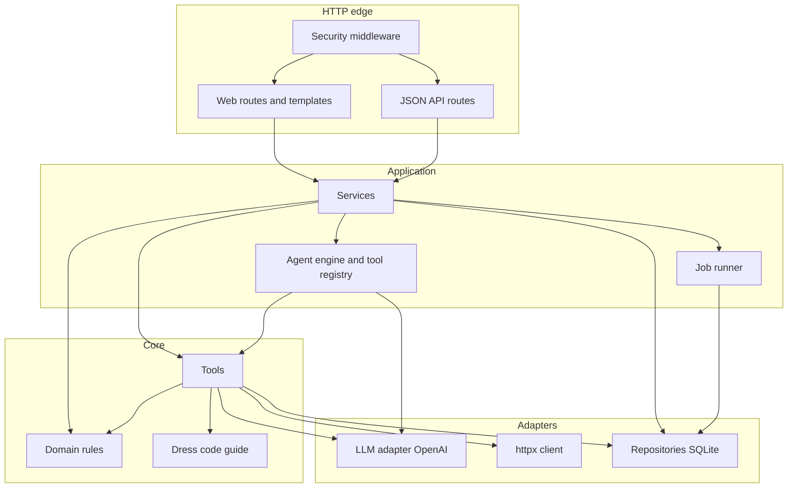

# Application Design: ClosetCast (Consolidated)

This document consolidates `components.md`, `component-methods.md`, `services.md` and `component-dependency.md`. Read those for full detail.

## 1. Design Decisions

| ID | Decision | Effect on earlier documents |
| --- | --- | --- |
| AD-1 | Services gather deterministic context (geocoding, weather, places, guidance, ranked closet) **before** calling the agent; the agent's ≤ 8 tool calls are for decisions | Keeps FR-9.2 workable for multi-day, multi-city trips; fewer LLM round trips (NFR-P.1) |
| AD-2 | One agent engine, configured per use case (`DAILY`, `OCCASION`, `TRIP`, `REFINE`, `GAP_DETAILS`) | Matches the ≤ 200-line loop in the technical environment |
| AD-3 | The agent has **no write tools**; services validate and save. `save_plan` is removed | **Supersedes** "tools are read-only except `save_plan`" (technical environment, FR-9.4, FR-9.5) |
| AD-4 | In-process job runner backed by a SQLite `job` table, with concurrency limits, backoff and resume on restart | Supports FR-1.3, FR-5.5, US-9.3 |
| AD-5 | HTML and API routes are both thin and call the same services | — |
| AD-6 | Repository per aggregate | FR-1.8 change log is in one place |
| AD-7 | Gaps detected in code; the LLM writes the buying details; code sets the priority | Gap detection is testable (and a PBT candidate) |
| AD-8 | App container built at startup, exposed via FastAPI `Depends` | All tests can use fakes (NFR-M.2) |

## 2. Architecture Overview

Text alternative: Security middleware wraps the web and API routes. Routes call services. Services call the agent engine, tools, domain rules, repositories and the job runner. The agent engine calls the LLM adapter and read-only tools. Tools call the httpx client (Open-Meteo, Nominatim), the LLM adapter (parsing, tagging), repositories (cache and reads), the dress-code guide and domain rules.

## 3. Components (summary)

| ID | Component | Package | Security-critical |
| --- | --- | --- | --- |
| C1 | Web UI | `web/` | |
| C2 | JSON API | `api/routes/` | |
| C3 | Security middleware | `security/middleware.py` | 🔒 |
| C4 | Upload validation | `security/uploads.py` | 🔒 |
| C5 | Services | `services/` | |
| C6 | Agent engine | `agent/` | |
| C7 | Tool registry | `agent/tools_registry.py` | 🔒 |
| C8 | LLM client adapter | `agent/llm.py` | |
| C9 | Tools | `tools/` | |
| C10 | Domain | `domain/` (`validate_outfit` 🔒) | 🔒 (validation) |
| C11 | Persistence | `db/` | |
| C12 | Job runner | `jobs/` | |
| C13 | Knowledge | `knowledge/` | |
| C14 | Platform | `main.py`, `config.py`, `logging_config.py`, `container.py` | 🔒 (global error handler, logging) |

## 4. Services (summary)
ClosetService, TaggingService, ProfileService, DailyOutfitService, OccasionService, TripService, PackingService, GapService, RefinementService, ContextBuilder, HealthService. All AI recommendations follow the **standard planning pattern**: context (code) → decision (agent) → validation (code; one retry; fail closed) → gaps (code + LLM text) → save.

## 5. Story-to-Component Coverage

| Epic | Stories | Services | Main components |
| --- | --- | --- | --- |
| EPIC-1 Closet | US-1.1–1.6 | ClosetService, TaggingService | C1, C2, C4, C9 (tagging), C11, C12 |
| EPIC-2 Profile | US-2.1–2.3 | ProfileService, ContextBuilder | C9 (geocoding, profile), C10 (preferences), C11 |
| EPIC-3 Daily | US-3.1–3.6 | DailyOutfitService, ProfileService | C6, C9, C10 (validation, variety, weather rules), C11 |
| EPIC-4 Occasion | US-4.1–4.4 | OccasionService | C6, C9 (parsing, guidance), C13 |
| EPIC-5 Trip | US-5.1–5.7 | TripService, ContextBuilder | C4 (PDF), C6, C9, C12 |
| EPIC-6 Packing | US-6.1–6.5 | PackingService | C10 (optimizer) |
| EPIC-7 Gaps | US-7.1–7.2 | GapService | C6 (GAP_DETAILS), C10 (gaps), C9 (search links) |
| EPIC-8 Refine | US-8.1–8.3 | RefinementService, PackingService | C6, C10 |
| EPIC-9 Cross-cutting | US-9.1–9.5 | ProfileService (notice), all AI services | C3, C7, C8, C10 (validation), C12, C14 |

All 41 stories map to at least one service and component.

## 6. Shared Contracts to Freeze First
`domain/models.py`, `domain/errors.py` (codes), the `LLMClient` Protocol, `UseCaseConfig`, repository interfaces, `AppContainer`, the job payload schemas, and the security middleware order. These form the natural **foundation unit** for Units Generation.

## 7. Extension Compliance (Application Design stage)

### Security Baseline

| Rule | Status | Notes |
| --- | --- | --- |
| SECURITY-01 | Compliant | No new data stores beyond SQLite and `data/images/` (full-disk encryption control); HTTPS for all outbound calls |
| SECURITY-02 | N/A | No load balancer, gateway or CDN |
| SECURITY-03 | Compliant | C14 logging + C3 request IDs |
| SECURITY-04 | Compliant | C3 SecurityHeadersMiddleware; vendored static assets, no inline scripts |
| SECURITY-05 | Compliant | Pydantic models on all routes and tool arguments (C7); C3 body size limit; C4 upload validation; SQLModel only |
| SECURITY-06 | N/A | No IAM |
| SECURITY-07 | N/A (equivalent) | 127.0.0.1 binding (C14) |
| SECURITY-08 | Compliant / partly N/A | C3 Host allowlist and Origin/CSRF check; no CORS; single user, no authentication |
| SECURITY-09 | Compliant | Debug-only `/docs`; generic errors through the global handler (C14) |
| SECURITY-10 | Compliant | No new dependencies added by this design (job runner and middleware use the standard library and existing libraries) |
| SECURITY-11 | Compliant | Security-critical logic in dedicated modules (C3, C4, C7, `domain/outfits.py`). Misuse cases addressed: prompt injection (delimited user data, read-only tools, AD-3, fail-closed validation), malicious uploads (C4), cross-site requests to localhost (C3), runaway agent (8-call cap) and job floods (concurrency limit, 20-file batch) |
| SECURITY-12 | N/A (except credentials) | API key only via settings (C14) |
| SECURITY-13 | Compliant | Pydantic parsing for all LLM output; closet change log in ClosetRepository; vendored assets |
| SECURITY-14 | Partly N/A | Log retention via C14; no alerting (local single-user) |
| SECURITY-15 | Compliant | Global handler (C14); explicit error mapping per service; fail-closed validation; the HTTP client is closed at shutdown |

### Property-Based Testing
N/A at this stage (rules apply from Functional Design). Design note for PBT-01: the domain functions (`optimize_packing`, `validate_outfit`, `check_composition`, `check_weather_fit`, `detect_gaps`, `rank_items`, unit conversion) are pure and are the main PBT targets.

### Resiliency Baseline
Disabled. NFR-R.1 to R.5 are reflected in C8 (timeouts, retry), C12 (resume, backoff), the service degradation table and HealthService.
