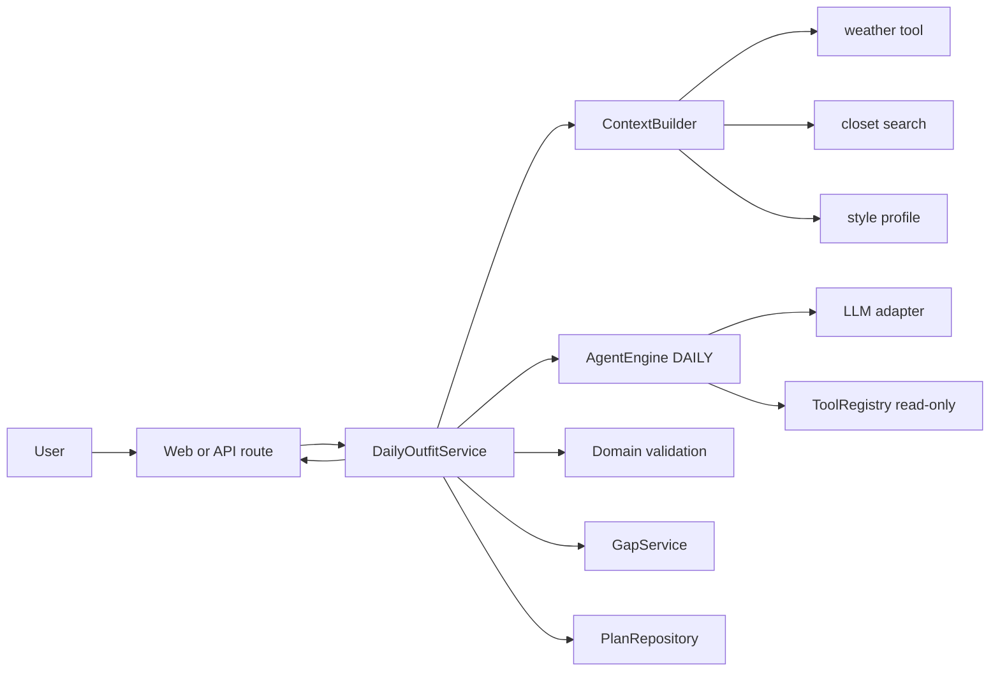
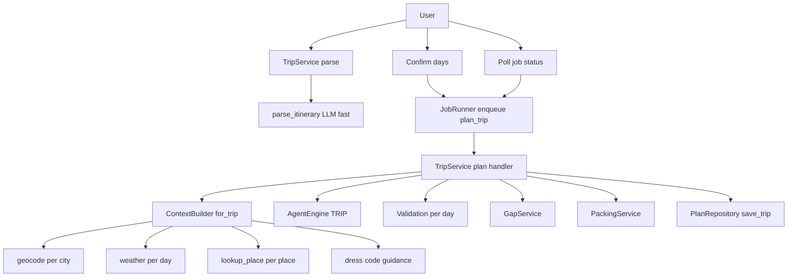

# Component Dependencies: ClosetCast

## Layering Rule
Calls go **downward only**: Routes → Services → (Agent Engine, Tools, Domain, Repositories, Job Runner) → (LLM adapter, httpx, DB). Domain depends on nothing except Pydantic. No component imports from a layer above it.

## Dependency Matrix

Rows call columns. ✔ = allowed and used; blank = not allowed.

| From \ To | Security MW | Services | Agent Engine | Tool Registry | LLM Adapter | Tools | Domain | Repositories | Job Runner | Knowledge | Upload Validation |
| --- | --- | --- | --- | --- | --- | --- | --- | --- | --- | --- | --- |
| Web routes (C1) | (wrapped by) | ✔ | | | | | ✔ (models only) | | | | |
| API routes (C2) | (wrapped by) | ✔ | | | | | ✔ (models only) | | | | |
| Services (C5) | | ✔ (Context/Gap/Packing) | ✔ | | | ✔ | ✔ | ✔ | ✔ | | ✔ |
| Agent Engine (C6) | | | | ✔ | ✔ | | ✔ (models) | | | | |
| Tool Registry (C7) | | | | | | ✔ | ✔ (models) | | | | |
| Tools (C9) | | | | | ✔ (parsing, tagging) | | ✔ | ✔ (cache, closet, profile reads) | | ✔ | |
| Job Runner (C12) | | ✔ (handlers) | | | | | ✔ | ✔ (jobs) | | | |
| Domain (C10) | | | | | | | | | | | |
| Repositories (C11) | | | | | | | ✔ (models) | | | | |

Note: the Job Runner calls service handlers (TaggingService, TripService.plan). This is the one place where a lower-level component calls up into services. It goes through handler registration at startup, not imports, so `jobs/` does not import `services/`.

## Communication Patterns

| Pattern | Where | Notes |
| --- | --- | --- |
| Synchronous request/response | Daily outfit, occasion plan, refinement, closet CRUD, profile | Target ≤ 15 s for daily (NFR-P.1) |
| Background job + polling | Photo tagging, trip planning | `job` table; HTMX polls every 2 s |
| Agent tool calls | Inside `AgentEngine.run` | Read-only tools; ≤ 8 per request |
| Outbound HTTPS | LLM adapter (OpenAI), tools (Open-Meteo, Nominatim) | Shared `httpx.AsyncClient` / OpenAI client; timeouts and retries |
| Cache-aside | weather, geocoding, places | CacheRepository with time-to-live (NFR-P.2) |

## Data Flow: Daily Outfit

Text alternative: User → route → DailyOutfitService → ContextBuilder (weather, closet search, style profile) → AgentEngine (DAILY; LLM adapter; read-only tools) → domain validation → GapService → PlanRepository (save by date) → response.

## Data Flow: Trip Planning

Text alternative:
1. The user submits text or a PDF; TripService.parse calls `parse_itinerary` (fast LLM model).
2. The user confirms the days; JobRunner enqueues `plan_trip`.
3. The handler builds context: geocodes each city, fetches weather per day, looks up places, gets dress-code guidance.
4. The handler runs AgentEngine (TRIP), validates each day, then calls GapService and PackingService and saves the trip.
5. Meanwhile the user polls the job status.

## Coupling Notes
- **Shared contracts** that must be frozen early (they belong to the foundation unit): `domain/models.py`, `domain/errors.py`, the `LLMClient` Protocol, `UseCaseConfig`, repository interfaces and `AppContainer`.
- Tools never call services or the agent.
- The knowledge guide is read-only data loaded once at startup.
