# Unit of Work Dependencies: ClosetCast

## Dependency Matrix

Rows depend on columns. ✔ = depends on; — = no dependency.

| Unit \ Depends on | U1 Foundation | U2 Closet, Profile & Gaps | U3 Daily, Occasion & Refine | U4 Trip & Packing |
| --- | --- | --- | --- | --- |
| U1 Foundation | — | — | — | — |
| U2 Closet, Profile & Gaps | ✔ | — | — | — |
| U3 Daily, Occasion & Refine | ✔ | ✔ | — | — |
| U4 Trip & Packing | ✔ | ✔ | ✔ | — |

There are no cycles. The order U1 → U2 → U3 → U4 satisfies every dependency (after the boundary adjustment in `unit-of-work.md`).

## What Each Unit Uses From Earlier Units

| Consumer | Provider | What is used |
| --- | --- | --- |
| U2 | U1 | Container, settings, logging, security middleware, upload validation, domain models and errors, JobRunner, AgentEngine (`GAP_DETAILS`), LLM adapter, base templates |
| U3 | U1 | Everything U2 uses, plus ContextBuilder (weather and geocoding), `validate_outfit`, weather rules, CacheRepository |
| U3 | U2 | `search_closet`, `get_style_profile` (ratings and preferences), worn log, GapService and the "to buy" display component |
| U4 | U1 | As U3, plus JobRunner for `plan_trip`, PDF extraction helper |
| U4 | U2 | Closet search, style profile, GapService ("Buy before you go" source) |
| U4 | U3 | `lookup_place` and place-type norms (US-5.5), `get_dress_code_guidance`, `check_composition`, the RefinementService structure (U4 adds trip methods), PlanRepository patterns |

## Shared Contracts and Their Providers

| Contract | File | Provider | Change rule |
| --- | --- | --- | --- |
| Domain models | `domain/models.py` | U1 | Additive only; PR reviewed by all three |
| Error codes | `domain/errors.py` | U1 | Additive only; codes never change meaning |
| LLM client Protocol | `agent/llm.py` | U1 | Additive only |
| Use-case configs | `agent/usecases.py` | U1 (engine); each unit adds its own configs | Add new configs; don't change others |
| Repository interfaces | `db/` | U1 (base), U2–U4 (their repositories) | Additive only |
| App container | `container.py` | U1 | Each unit registers its services additively |
| Job payload schemas | `jobs/` + `domain/models.py` | U1 (runner), U2 (`tag_photo`), U4 (`plan_trip`) | Additive only |
| Place-norm capability | `tools/places.py`, `tools/dress_codes.py` | U3 | U4 consumes only; changes reviewed by U3's owner |

## Build Order and Integration Checkpoints

```mermaid
flowchart LR
    U1["U1 Foundation and Agent Core<br/>whole team"] --> C1{{"Checkpoint 1<br/>U1 merged, live smoke test passes"}}
    C1 --> U2["U2 Closet Profile Gaps<br/>May Wu"]
    U2 --> C2{{"Checkpoint 2<br/>Journey J1 up to tagged closet"}}
    C2 --> U3["U3 Daily Occasion Refine<br/>Katherine Yang"]
    U3 --> C3{{"Checkpoint 3<br/>J1, J2, J4 work end to end"}}
    C3 --> U4["U4 Trip Packing<br/>Emma Dai"]
    U4 --> C4{{"Checkpoint 4<br/>J3 and J5 work, all 41 stories"}}
    C4 --> BT["Build and Test"]
```

### Text alternative
1. **U1 Foundation & Agent Core** (whole team) → **Checkpoint 1**: U1 merged to `main`; the quality gate passes; the live OpenAI smoke test passes (confirms structured output and tool-calling call shapes).
2. **U2 Closet, Profile & Gaps** (May Wu) → **Checkpoint 2**: journey J1 works up to a tagged, editable closet and saved profile; GapService works on sample inputs.
3. **U3 Daily, Occasion & Refine** (Katherine Yang) → **Checkpoint 3**: journeys J1 (through the first outfit), J2 and J4 work end to end.
4. **U4 Trip & Packing** (Emma Dai) → **Checkpoint 4**: journeys J3 and J5 work; all 41 stories meet their acceptance criteria.
5. **Build and Test**.

## Parallel Work Within the Sequence
AI-DLC sessions run one unit at a time (Q4 = A), but people can prepare ahead without waiting:
- **During U1:** May starts collecting the 60 labeled photos; Katherine drafts the dress-code guide list (types only); Emma writes 10 sample itineraries (NFR-Q.4).
- **During U2:** Katherine and Emma review U2 PRs and write test scenarios for their units (20 weather scenarios for NFR-Q.2; packing cases for NFR-Q.5).
- **During U3 and U4:** the earlier owners fix bugs in their units, run manual accessibility checks (NFR-U.2) and prepare testing week.
