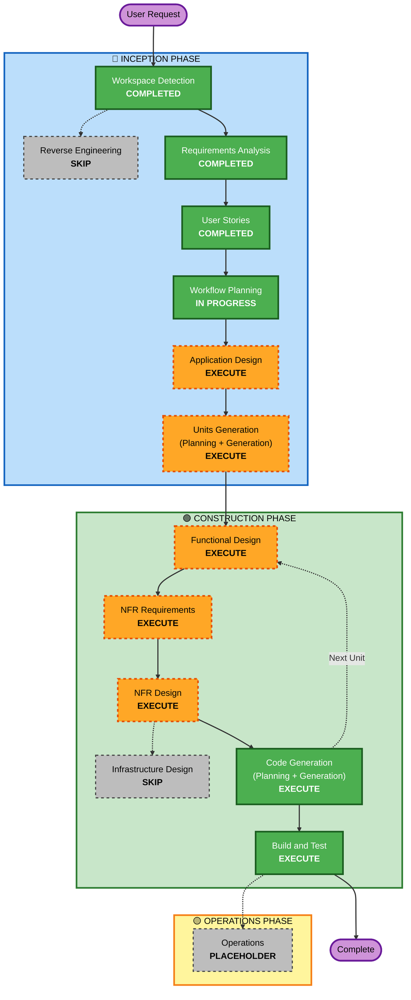

# Execution Plan: ClosetCast

**Stage**: INCEPTION - Workflow Planning
**Date**: 2026-11-19
**Inputs**: `requirements.md` (approved), `requirement-verification-questions.md`, `requirement-clarification-questions.md`, `stories.md` and `personas.md` (approved)

---

## Detailed Analysis Summary

### Transformation Scope
Not applicable (greenfield project; no existing code).

### Change Impact Assessment
- **User-facing changes**: Yes. The whole product is new: 8 features, 41 stories, 9 HTML pages and their HTMX partials.
- **Structural changes**: Yes. A new layered modular monolith (`api`, `web`, `agent`, `tools`, `domain`, `db`, `knowledge`), an LLM agent loop with about 9 tools, and a background task queue.
- **Data model changes**: Yes. New SQLite schema: closet items, tags, profile, ratings, worn log, daily outfits by date, occasion plans, trip plans and days, packing results, gap suggestions, a cache for weather, geocoding and places, and the closet change log.
- **API changes**: Yes. A new JSON API under `/api/...`, HTML pages, status-polling endpoints and `/health`.
- **NFR impact**: Yes.
  - **Security:** Security Baseline enabled (headers, CSRF and Host checks, upload validation, logging).
  - **Performance:** ≤ 15 s daily outfit, ≤ 90 s trip plan.
  - **Reliability:** timeouts, retries and graceful degradation.
  - **Accessibility:** WCAG 2.1 AA.
  - **Testing:** property-based testing (PBT) enabled.

### Risk Assessment
- **Risk Level**: Medium. The technology is well understood, but the scope is large for about 3 weeks of Construction, and three external services plus LLM behavior add uncertainty. There is no production data, and nothing to migrate.
- **Rollback Complexity**: Easy (git, local app, schema created at startup)
- **Testing Complexity**: Complex. LLM output is non-deterministic and needs fake clients. External APIs need mocking. The optimizer needs property-based tests. Accessibility checks are partly manual.

### Main Risks to Watch
| Risk | Mitigation in this plan |
| --- | --- |
| Scope too large for Nov 24 – Dec 16 | Units Generation orders units by the critical path (closet → daily outfit → trip → packing, FR-1 → 3 → 5 → 6); gap finder and refine (FR-7, FR-8) can be simplified |
| Three people working in parallel on shared models | Application Design fixes shared interfaces (domain models, the LLM `Protocol`, tool signatures) before Construction starts |
| OpenAI SDK details (structured output, function calling) | Confirmed early in the first unit that touches the LLM; the live smoke test runs before other units depend on it |

---

## Workflow Visualization



### Text Alternative
```
Phase 1: INCEPTION
- Workspace Detection ........ COMPLETED
- Reverse Engineering ........ SKIPPED (greenfield)
- Requirements Analysis ...... COMPLETED
- User Stories ............... COMPLETED
- Workflow Planning .......... IN PROGRESS
- Application Design ......... EXECUTE
- Units Generation ........... EXECUTE

Phase 2: CONSTRUCTION (repeat per unit)
- Functional Design .......... EXECUTE
- NFR Requirements ........... EXECUTE
- NFR Design ................. EXECUTE
- Infrastructure Design ...... SKIP (local app, no cloud)
- Code Generation ............ EXECUTE
Then once:
- Build and Test ............. EXECUTE

Phase 3: OPERATIONS
- Operations ................. PLACEHOLDER
```

---

## Phases to Execute

### 🔵 INCEPTION PHASE
- [x] Workspace Detection (COMPLETED)
- [x] Reverse Engineering (SKIPPED: greenfield, no existing code)
- [x] Requirements Analysis (COMPLETED, comprehensive depth)
- [x] User Stories (COMPLETED: 3 personas, 41 stories)
- [x] Execution Plan (IN PROGRESS)
- [ ] Application Design - **EXECUTE**
  - **Rationale**: Every component is new. The design must define the layers, the agent loop and its tool registry (final tool set per FR-9.5), service classes per use case, the LLM client `Protocol`, the background job and status mechanism, and the security middleware module (NFR-S.8). Fixing these shared interfaces before Construction lets three people work in parallel without conflicts.
- [ ] Units Generation - **EXECUTE**
  - **Rationale**: 41 stories across 9 epics need to be split into units that individual team members can own (README collaboration plan). Units must be ordered by dependency and the critical path (FR-1 → 3 → 5 → 6), and shared foundations (config, database, domain models, LLM client, security middleware) must be identified.

### 🟢 CONSTRUCTION PHASE
- [ ] Functional Design - **EXECUTE** (per unit)
  - **Rationale**: Complex business rules need precise definition before code: the packing optimizer (bulk scores, luggage budgets, re-wear rules, determinism), weather rules (forecast vs. typical, thresholds in NFR-Q.2), outfit composition (D8), variety (A3), rating influence (D9), the curated dress-code guide (about 15–20 types, plan Q8 = A), and the data schema. Also **required by PBT-01**: testable properties must be identified here.
- [ ] NFR Requirements - **EXECUTE** (per unit; light where the stack is already fixed)
  - **Rationale**: The tech stack is mostly fixed by the technical environment, but this stage must confirm the PBT framework (Hypothesis, **PBT-09**), the OpenAI model and SDK details (D20), timeout and retry values (NFR-R.1, NFR-R.2), performance budgets, and the Security Baseline controls that apply to each unit.
- [ ] NFR Design - **EXECUTE** (per unit, where the unit has NFR impact)
  - **Rationale**: These patterns must be designed, not improvised: the security middleware (headers, CSP, Host allowlist, Origin/CSRF check), structured logging with request IDs, retry/backoff and timeouts, graceful degradation, upload validation, the tagging queue, and caching. Units with no NFR impact record "N/A" briefly.
- [ ] Infrastructure Design - **SKIP**
  - **Rationale**: There is no cloud or deployment infrastructure. The app runs locally (`uv run closetcast` on `127.0.0.1`), and the data store is a local SQLite file. Local setup steps (full-disk encryption check, `.env`, backup of `data/`) are documented in Build and Test.
- [ ] Code Generation - **EXECUTE** (ALWAYS, per unit)
  - **Rationale**: Implementation planning and code generation needed.
- [ ] Build and Test - **EXECUTE** (ALWAYS)
  - **Rationale**: Build, test and verification needed: quality gate (ruff, mypy, pytest), coverage, PBT with seed logging (PBT-08), pip-audit and SBOM (NFR-S.7), accessibility checks (NFR-U.2), and the success-metric checks (NFR-Q).

### 🟡 OPERATIONS PHASE
- [ ] Operations - PLACEHOLDER
  - **Rationale**: Future deployment and monitoring workflows; not needed for a locally run course project.

---

## Estimated Timeline

| Period | Work |
| --- | --- |
| Nov 19 – Nov 23 | Remaining Inception: Application Design, Units Generation |
| Nov 24 – Dec 12 | Construction: per-unit loop (Functional Design → NFR Requirements → NFR Design → Code Generation), with units owned by different team members running in parallel after the shared foundation unit |
| Dec 12 – Dec 16 | Build and Test, success-metric checks, testing week with outside testers, demo preparation |

- **Total stages**: 13 (4 completed, 2 skipped, 7 remaining kinds of stages; Construction stages repeat per unit)
- **Stages still to execute**: Application Design, Units Generation, Functional Design, NFR Requirements, NFR Design, Code Generation, Build and Test

---

## Success Criteria

- **Primary goal**: A locally running ClosetCast with all 8 MVP features working end to end, demonstrated through key journeys J1–J4, with J5 (AI outage) handled safely.
- **Key deliverables**:
  - Application code in `src/closetcast/` and tests in `tests/`
  - Curated dress-code guide in `src/closetcast/knowledge/`
  - Updated README with setup steps (OpenAI key, full-disk encryption check, backup)
  - AI-DLC documentation in `aidlc-docs/` (design, plans, build-and-test instructions, audit trail)
- **Quality gates**:
  - `ruff check`, `ruff format --check`, `mypy --strict src` and `pytest` pass before every merge to `main`
  - Coverage ≥ 80% for `domain/` and `tools/`; ≥ 60% overall
  - Property-based tests for the optimizer and validation, with seeds logged (PBT extension)
  - Security Baseline: no open blocking findings at any stage
  - `pip-audit` clean and an SBOM generated at each milestone
  - Success metrics NFR-Q.1 to NFR-Q.6 measured and reported
