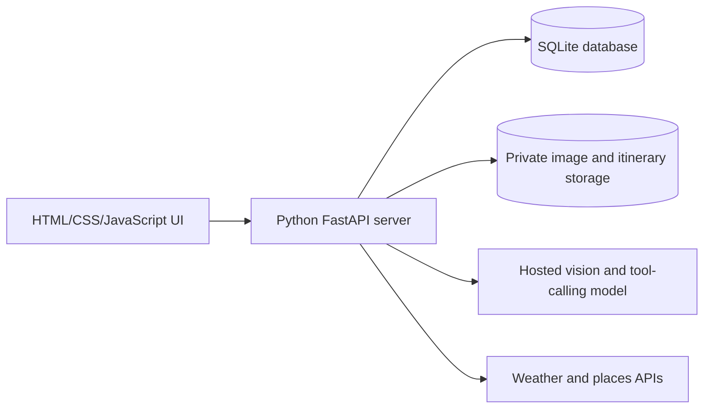

# Architecture

Proposed design: one Python application with a simple web UI and separate domain modules. FastAPI, Jinja2, and SQLite are proposed implementation choices.

## Modules

| Module | Responsibility |
| --- | --- |
| Profile | Authentication, style, sizes, and budget |
| Closet | Uploads, attribute review, browsing, editing, and deletion |
| AI gateway | Hosted model requests, Pydantic validation, retries, and fallbacks |
| External tools | Validate and execute weather/place lookups requested by the model |
| Outfits | Compatible combinations, swaps, saved outfits, and feedback |
| Plans | Itinerary parsing, event details, confirmed activities, and packing lists |
| Analysis | Wardrobe gaps for daily life, trips, and events; evidence for reuse or purchases |
| Shopping | Catalog filtering, explanations, cart totals, and approval |

## Data Flow

**Clothing:** validate upload → store private image → infer attributes → user reviews → save item.

**Travel/events:** upload itinerary or enter details → extract and confirm activities → generate outfits → consolidate an editable packing list → identify missing pieces.

**Context lookup:** model requests a weather/place tool → Python validates arguments and calls the API → results inform outfits; failed lookups fall back to manual input.

**Shopping:** analyze closet and confirmed plans → filter catalog by size and budget → rank compatible products → explain enabled outfits and activity needs → user edits cart → validate and record simulated approval.

AI output cannot bypass server checks. Recommendations reference stored item IDs; no matching product is a valid result.

## Key Decisions

- A responsive web app and single deployment keep the semester scope manageable.
- A Python backend with template-based pages matches the team's preferred stack. Hosting and authentication libraries remain to be selected.
- A curated catalog makes recommendations reproducible without retailer integrations.
- A shared AI gateway keeps model-specific code separate from business rules.

If clothing or itinerary analysis fails, offer manual entry or retry. If the closet cannot support an activity's outfit, explain what is missing. If no purchase is useful, suggest buying nothing. Packing lists keep suggested purchases separate from owned items.

The proposed tools and security practices are in the [technical environment](../../TECHNICAL_ENVIRONMENT.md).

